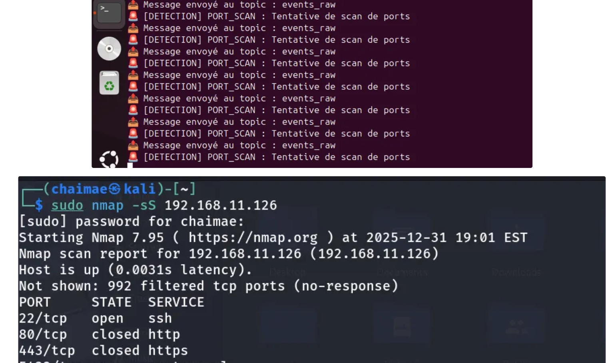
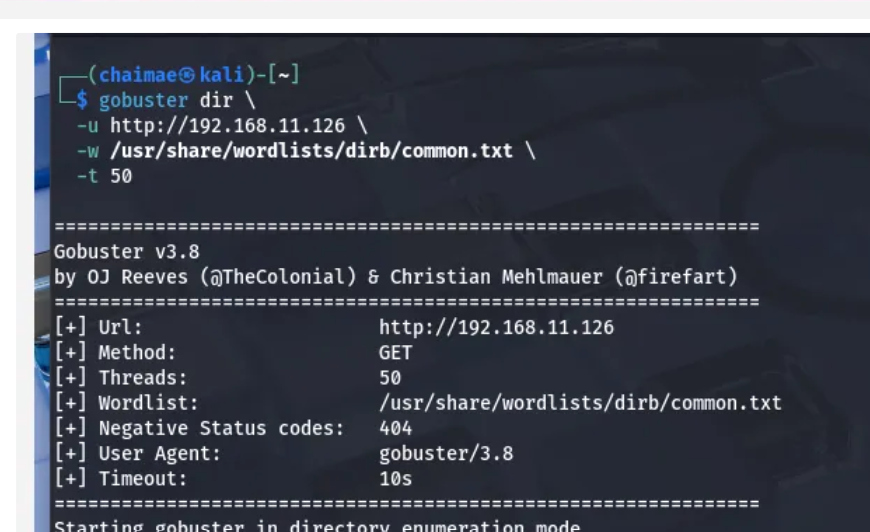

# 🛡️ AI-Powered Security Operations Center (SOC)

[](https://www.python.org/)
[](https://attack.mitre.org/)
[](https://kafka.apache.org/)
[](https://llama.meta.com/)

> An intelligent Security Operations Center that autonomously detects and responds to cyberattacks using Large Language Models (Llama 3), Machine Learning, and explainable AI mapped to the MITRE ATT&CK framework.

[🎥 Watch Demo](#demo) | [📖 Read Docs](#documentation) | [🚀 Quick Start](#quick-start) | [📊 Results](#current-status-and-results)

---

## 🎯 Project Highlights

Academic / lab project. A multi-agent Security Operations Center pipeline that:

- Ingests system logs, extracts features, and scores anomalies with Isolation Forest
- Sends events to a **local** Llama 3 model (LM Studio) for threat assessment
- Applies fixed temperature scaling (`T = 1.5`) to the model's confidence score
- Maps matched events to MITRE ATT&CK techniques T1110, T1046, and T1190
- Generates a short natural-language explanation and a BLOCK / ALERT / MONITOR action
- Uses Apache Kafka between agents and a Flask dashboard for inspection

Lab simulations (screenshots in `screenshots/`) include SSH brute-force-style activity, Nmap scanning, and Gobuster web fuzzing. This repository does not yet include a labeled evaluation or published detection metrics.

---

## 📋 Table of Contents

- [Overview](#overview)
- [Architecture](#architecture)
- [Features](#features)
- [Quick Start](#quick-start)
- [Installation](#installation)
- [Usage](#usage)
- [Current status and results](#current-status-and-results)
- [Project Structure](#project-structure)
- [Technologies](#technologies)
- [Contributing](#contributing)
- [License](#license)
- [Contact](#contact)

---

## 🔍 Overview

This project explores how a **local**, privacy-preserving stack (Kafka, Isolation Forest, Llama 3 via LM Studio) can be wired into a SOC-style pipeline: ingest, detect, explain, and respond, with MITRE ATT&CK tags on matched events.

It is a lab / academic system, not a production SOC. Detection currently combines:

- Heuristic flags (for example failed-authentication keywords and HTTP error responses)
- An Isolation Forest trained online after a warmup of 80 events
- An LLM judgment, with a fixed temperature-scaling step on the confidence score
- Regex-based MITRE mapping from `data/mitre/techniques.csv` (three techniques)

---

## 🏗️ Architecture

### High-Level Pipeline

```
┌─────────────┐     ┌──────────────┐     ┌──────────────┐     ┌────────────┐
│  Log Tailer │ --> │  Collector   │ --> │   Features   │ --> │  Anomaly   │
│ /var/log/*  │     │ (Normalize)  │     │  Extractor   │     │  Detector  │
└─────────────┘     └──────────────┘     └──────────────┘     └────────────┘
                                                                      |
                    ┌──────────────┐     ┌──────────────┐           |
                    │  Responder   │ <-- │   Analyzer   │ <---------+
                    │   (Action)   │     │ (LLM: Llama3)│
                    └──────────────┘     └──────────────┘
                           |                     |
                    ┌──────v──────┐     ┌───────v────────┐
                    │ Trust Agent │     │ MITRE Mapper   │
                    │ (Calibrate) │     │ XAI Explainer  │
                    └─────────────┘     └────────────────┘
```

### Component Flow

| Component | Input | Output | Function |
|-----------|-------|--------|----------|
| **Log Tailer** | System logs | Raw events | Reads `/var/log/auth.log`, `/var/log/nginx/access.log` |
| **Collector** | Raw events | Normalized events | Enriches with metadata (timestamp, source IP) |
| **Feature Extractor** | Normalized events | Feature vectors | Extracts ML features (frequency, time deltas, codes) |
| **Anomaly Detector** | Feature vectors | Anomaly scores | Isolation Forest assigns 0-1 anomaly score |
| **Analyzer** | Events + scores | Threat assessment | LLM (Llama 3) analyzes threat level + confidence |
| **Trust Agent** | LLM confidence | Calibrated confidence | Platt/Temperature Scaling reduces false positives |
| **MITRE Mapper** | Threat events | MITRE techniques | Maps attacks to ATT&CK framework (T1110, T1046, T1190) |
| **XAI Explainer** | MITRE events | Explanations | Generates human-readable justifications |
| **Responder** | Final events | Actions | BLOCK / ALERT / MONITOR based on threat level |

### Distributed Architecture (Kafka)

All agents communicate via **Apache Kafka topics** for scalability:

```
events_raw → events_collected → events_with_features → events_with_anomaly
→ events_analyzed → events_calibrated → events_with_mitre → events_explained
→ events_final → alerts
```

---

## ✨ Features

### 🤖 AI-Powered Detection
- **Local LLM Integration**: Llama 3 (8B) via LM Studio for privacy & low-latency
- **Hybrid Scoring**: Combines heuristics + ML anomaly scores + LLM assessment
- **Zero-Day Detection**: Unsupervised learning detects unknown attack patterns

### 📊 Machine learning and calibration

- **Isolation Forest** on a small feature set (`has_failed`, `msg_len`, `hour`, `is_http`, `is_error`), trained online after 80 events.
- **Temperature scaling** with a fixed `T = 1.5` (not a calibrator fitted on a labeled set; Platt scaling is not implemented).
- Unit tests cover feature extraction and that calibrated confidence stays in [0, 1]. A formal ROC / Brier evaluation is not in this repository yet.

### 🔍 Explainability
- **MITRE ATT&CK Mapping**: Automatic technique classification (T1110, T1046, T1190)
- **XAI Module**: Natural language explanations for every threat decision
- **Transparency**: Full audit trail of detection logic

### 🎯 Attack coverage (lab)

Exercised in a lab against:

- SSH brute-force style activity → T1110
- Port scanning (Nmap) → T1046
- Web fuzzing (Gobuster) → T1190

See `screenshots/` for examples. These are demonstrations, not a measured detection rate.

---

## 🚀 Quick Start

### Prerequisites

- **OS**: Ubuntu 20.04+ (or Docker)
- **RAM**: 16GB minimum
- **Disk**: 100GB free space
- **Python**: 3.10+
- **Docker**: Latest version

### One-Command Setup (Docker)

```bash
git clone https://github.com/chaimaebouassab4-boop/AI-Powered-Security-Operations-Center-SOC-.git
cd AI-Powered-Security-Operations-Center-SOC-
docker-compose up -d
./scripts/setup.sh
./scripts/start_all.sh
```

### Access Dashboard

```bash
# Open in browser
http://localhost:5000
```

### Run Test Attacks

```bash
# From Kali Linux machine
cd attacks/scripts
./run_all_attacks.sh
```

---

## 📦 Installation

### Step 1: Clone Repository

```bash
git clone https://github.com/chaimaebouassab4-boop/AI-Powered-Security-Operations-Center-SOC-.git
cd AI-Powered-Security-Operations-Center-SOC-
```

### Step 2: Install Dependencies

```bash
# System packages
sudo apt update && sudo apt install -y python3 python3-pip docker.io

# Python environment
python3 -m venv venv
source venv/bin/activate
pip install -r requirements.txt
```

### Step 3: Start Infrastructure

```bash
# Start Kafka, Zookeeper, PostgreSQL
docker-compose up -d

# Create Kafka topics
./scripts/create_topics.sh

# Initialize database
./scripts/init_db.sh
```

### Step 4: Install LM Studio

```bash
# Download from: https://lmstudio.ai/
# Install and download Llama-3-8B-Instruct model
# Start local server on port 1234
```

### Step 5: Configure

```bash
# Edit configuration
nano config/config.yaml

# Set your network IPs for Kali/Ubuntu
nano attacks/config_attacks.yaml
```

### Step 6: Start Agents

```bash
# Start all SOC agents
./scripts/start_all.sh

# Check logs
tail -f logs/soc-ia.log
```

---

## 💻 Usage

### Running the Complete Pipeline

```bash
# Start SOC
source venv/bin/activate
./scripts/start_all.sh

# In another terminal, monitor events
docker exec kafka kafka-console-consumer \
  --bootstrap-server localhost:9092 \
  --topic events_final \
  --from-beginning
```

### Simulating Attacks (from Kali Linux)

```bash
# SSH Brute-Force
cd attacks/scripts
./01_ssh_bruteforce.sh

# Network Scan
./02_nmap_scan.sh

# Web Fuzzing
./03_http_fuzzing.sh

# Or run all attacks
./run_all_attacks.sh
```

### Viewing Results

```bash
# Web dashboard
http://localhost:5000

# Database query
psql -h localhost -U socuser -d socdb
SELECT * FROM events WHERE threat_level = 'critical';

# Jupyter notebooks (analysis)
cd notebooks
jupyter notebook
```

---

## 📊 Current status and results

There is **no published evaluation dataset or metrics report** in this repository, so this README does not claim an accuracy or workload figure.

What *is* documented today:

- End-to-end agent pipeline and Kafka topic flow (see Architecture above)
- Isolation Forest anomaly scoring and a fixed-temperature confidence step
- Regex MITRE mapping for T1110, T1046, and T1190
- Lab screenshots of Nmap, Gobuster, and pipeline events
- Unit tests for features, a basic anomaly path, and confidence range checks
- An integration test that waits for an event to reach `events_final` (allowed latency: under 60 seconds)

The project report included in the repo lists *target* metrics (for example detection rate >90%, false positives <10%). Those are goals, not measured results.

### Example event shape

The JSON example below is illustrative of the fields the pipeline is designed to attach. It is not an evaluation result.

```json
{
  "message": "Failed password for admin from 192.168.1.100",
  "anomaly_score": 0.89,
  "threat_level": "critical",
  "mitre_techniques": [
    {"technique_id": "T1110", "technique_name": "Brute Force", "tactic": "Credential Access"}
  ],
  "action_taken": "BLOCK"
}
```

---

## 📁 Project Structure

```
AI-Powered-Security-Operations-Center-SOC-/
├── agents/                      # All SOC agents
│   ├── common/                  # Shared utilities
│   │   ├── kafka_utils.py       # Kafka producer/consumer
│   │   └── lm_client.py         # LM Studio API client
│   ├── log_tailer/              # Log ingestion
│   ├── collector/               # Event normalization
│   ├── features/                # Feature extraction
│   ├── anomaly_detector/        # Isolation Forest ML
│   ├── analyzer/                # LLM threat analysis
│   ├── trust_agent/             # Confidence calibration
│   ├── mitre_mapper/            # MITRE ATT&CK mapping
│   ├── xai_explainer/           # Explainable AI
│   ├── responder/               # Automated response
│   └── supervisor/
│
├── config/
│   └── config.yaml              # Central config
│
├── data/
│   └── mitre/                   # MITRE techniques (T1110, T1046, T1190)
│
├── dashboard/                   # Web dashboard
│   ├── app.py
│   └── templates/
├── dashboard_flask/             # Alternate Flask dashboard
│
├── scripts/
│   ├── start_all.sh             # Start all agents
│   └── create_topics.sh         # Kafka setup
│
├── tests/                       # Unit & integration tests
├── screenshots/                 # Lab captures (Nmap, Gobuster, pipeline events)
├── logs/
├── docker-compose.yml
├── requirements.txt
├── README.md
├── report with steps ofAI-Powered Security Operations Center.pdf
└── soc pipelines.pdf
```

---

## 🛠️ Technologies

### Core Technologies

- **Python 3.10+**: Main programming language
- **Apache Kafka**: Message queue for distributed architecture
- **PostgreSQL**: Event storage and analytics
- **Docker**: Containerization

### AI/ML Stack

- **LM Studio + Llama 3 (8B)**: Local LLM inference
- **scikit-learn**: Machine Learning (Isolation Forest)
- **NumPy/Pandas**: Data processing

### Security Tools

- **MITRE ATT&CK Framework**: Threat intelligence taxonomy
- **Kali Linux**: Attack simulation environment
- **Hydra**: SSH brute-force testing
- **Nmap**: Network scanning
- **Gobuster**: Web fuzzing

### DevOps

- **Flask**: Web dashboard
- **Jupyter**: Scientific analysis
- **Docker Compose**: Service orchestration

---

## 📈 Roadmap

- [x] Core pipeline (log_tailer → responder)
- [x] ML anomaly detection (Isolation Forest)
- [x] LLM integration (Llama 3)
- [x] Confidence calibration
- [x] MITRE ATT&CK mapping
- [x] Explainable AI (XAI)
- [x] Kafka distributed architecture
- [ ] Real-time dashboard (Grafana)
- [ ] Advanced ML models (Deep Learning)
- [ ] Multi-model LLM support (Mixtral, GPT)
- [ ] API for external integrations
- [ ] Kubernetes deployment


## 🙏 Acknowledgments

- **MITRE ATT&CK** for the threat intelligence framework
- **LM Studio** for local LLM inference
- **Apache Kafka** community
- **scikit-learn** contributors
- **FSTT** faculty for academic support

---

## 📚 Documentation

Additional write-ups bundled in this repository:

- [Project report (setup and components)](report%20with%20steps%20ofAI-Powered%20Security%20Operations%20Center.pdf)
- [SOC pipelines](soc%20pipelines.pdf)

---

## 🎥 Demo

Lab screenshots in `screenshots/`:






<div align="center">

Made with ❤️ by Chaimae | 🛡️ Securing the Future with AI

</div>
